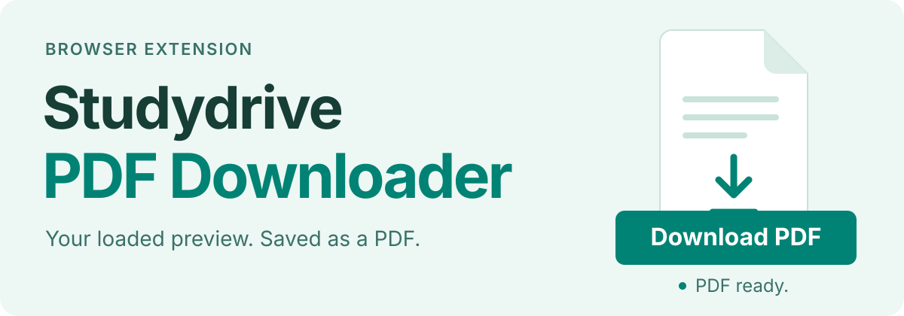

<p align="center">
  
</p>

# Studydrive PDF Downloader

Save the PDF preview you are reading on Studydrive. A lightweight Chromium extension adds a **Download PDF** button directly to document pages.

**[Download the latest release · ZIP](https://github.com/Skriipt/studydrive-pdfdownloader/releases/latest/download/studydrive-pdfdownloader.zip)** · [Installation](#installation) · [Troubleshooting](#troubleshooting)

Chrome **111+** or a compatible Chromium desktop browser · Manifest V3 · No dependencies or build step

> **Preview, not necessarily the full document.** The saved PDF contains the preview loaded by Studydrive, which may have fewer pages than the original. Maximum file size: **40 MiB**.

## From preview to PDF

1. **Open a document.** Sign in to [studydrive.net](https://www.studydrive.net) and open the document you want to save.
2. **Wait for the teal “Download PDF” button.** The extension observes the preview as the viewer loads it and shows capture progress when the size is known.
3. **Click “Download PDF” or press <kbd>Alt</kbd>+<kbd>Shift</kbd>+<kbd>D</kbd>.** The file is saved through your browser. “Download started” means the browser accepted it; check browser downloads for completion.

Hid the controls with ×? Click the extension's toolbar icon to show them again. The icon shows a **PDF** badge when a preview is ready and **!** when something needs attention. The interface is available in English and German.

The extension uses the already-loaded preview. It makes no additional document requests and does not fetch missing pages.

## Installation

1. [Download the release ZIP](https://github.com/Skriipt/studydrive-pdfdownloader/releases/latest/download/studydrive-pdfdownloader.zip) and extract it to a permanent folder.
2. Open `chrome://extensions` and enable **Developer mode**.
3. Click **Load unpacked** and select the extracted folder containing `manifest.json`.
4. Reload any Studydrive tabs that were already open. A short local welcome page opens once after installation; you can reopen it from the extension's **Options**.

Installing from source? Select the repository’s `extension/` folder instead. No build is needed.

## Privacy & limits

- **No analytics or external transmission.** The extension processes the preview in your browser and saves it through the browser’s downloads API.
- **One API permission: `downloads`.** Content scripts run on `https://www.studydrive.net/*`; download controls appear on document pages.
- **Complete previews only, up to 40 MiB.** Partial or range responses are unsupported; missing parts are not assembled.
- **No access-control bypass.** Use only documents you are authorized to download.

## Troubleshooting

**Stuck on “Waiting for preview…”?** Let the preview load. After a few seconds the controls offer **Reload page**; use it if the document is already visible so the extension can observe its request.

**A partial-preview or size error?** The viewer must supply a complete PDF within the 40 MiB limit. The extension cannot reconstruct a partial response.

**No download confirmation?** Check browser downloads before trying again; the download may already have started.

**Want the exact error?** Open **Technical details** below the message.

For other errors, site-access checks and capture limitations, see [development & troubleshooting](docs/DEVELOPMENT.md).

## Development

Load `extension/` as an unpacked extension. To run the repository checks with Node.js 22+ and Python 3.10+:

```bash
node scripts/check.js
```

See the [development guide](docs/DEVELOPMENT.md) for the browser fixture, security boundary and release packaging.

## Also for Studydrive

[Studydrive Adblock Filters](https://github.com/Skriipt/studydrive-adblock-filters) hides Studydrive ads, Premium prompts and anti-adblock banners with uBlock Origin or uBO Lite. It is a separate, optional project.
