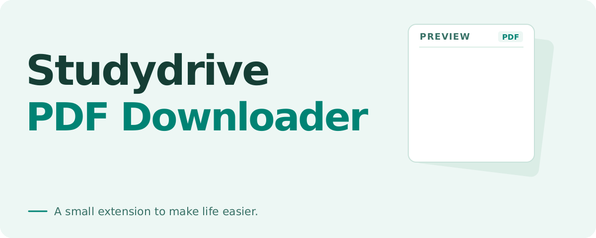

<p align="center">
  
</p>

# Studydrive PDF Downloader

Keep the PDF preview you are reading on Studydrive. This small Chromium extension adds a **Download PDF** button directly to document pages.

**[Download the extension · ZIP](https://github.com/Skriipt/studydrive-pdfdownloader/releases/latest/download/studydrive-pdfdownloader.zip)** · [Install](#installation) · [Need help?](#troubleshooting)

Chrome **111+** or a compatible Chromium desktop browser · Manifest V3 · No build step

> **The loaded preview, not necessarily the full document.** Your PDF may contain fewer pages than the original. Complete preview responses only, up to **40 MiB**.

## Open. Load. Save.

1. **Open a document** on [studydrive.net](https://www.studydrive.net) while signed in.
2. **Wait for “PDF ready.”** Let the viewer load its preview.
3. **Click “Download PDF”.** Check your browser’s downloads for completion.

The extension captures the preview the viewer already loads. It makes no additional document requests and does not fetch missing pages. The animation above illustrates this flow; it is not a site screenshot.

## Installation

1. [Download the ZIP](https://github.com/Skriipt/studydrive-pdfdownloader/releases/latest/download/studydrive-pdfdownloader.zip) and extract it to a permanent folder.
2. Open `chrome://extensions` and enable **Developer mode**.
3. Choose **Load unpacked**, then select the folder containing `manifest.json`.
4. Reload your open Studydrive tabs.

From source, select the repository’s `extension/` folder instead. No build is needed.

## Small scope. Local processing.

- **No analytics or external transmission.** Preview data stays in your browser and is saved through its downloads API.
- **One API permission: `downloads`.** Content scripts run on `https://www.studydrive.net/*`; controls appear on document pages.
- **No partial-response assembly.** Range responses and missing pages are unsupported.
- **No access-control bypass.** Use only documents you are authorized to download.

## Troubleshooting

**“Waiting for PDF”?** Let the preview load. If it is already visible, reload the document so the extension can observe its request.

**Partial-preview or size error?** The viewer must supply a complete PDF within the 40 MiB limit.

**No download confirmation?** Check browser downloads before trying again; the download may already have started.

More errors and capture limitations are covered in the [development guide](docs/DEVELOPMENT.md).

## Development

Load `extension/` as an unpacked extension. With Node.js 22+ and Python 3.10+, run:

```bash
node scripts/check.js
```

See [development & release packaging](docs/DEVELOPMENT.md) for the browser fixture and security boundary.

## Also for Studydrive

[Studydrive Adblock Filters](https://github.com/Skriipt/studydrive-adblock-filters) is our separate, optional project for hiding ads, Premium prompts and anti-adblock banners with uBlock Origin or uBO Lite.
